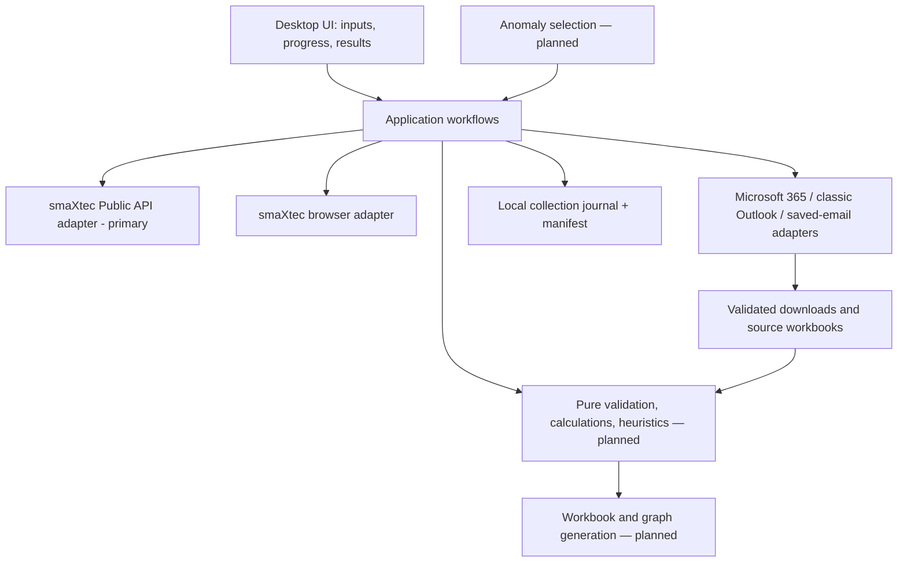

# Architecture and decision record

## North star

A self-contained, approachable desktop application for a nontechnical user.
Initial target: Windows x64, inferred from the current working environment.
Supporting macOS or Linux later is possible, but each requires its own build and
verification. The final deliverable must bundle the language runtime, dependencies,
and automation browser and provide a polished installer and GUI onboarding.

## Boundaries

The automated anomaly path will produce the same direct-data target inputs as manual
selection. There must be one collection/normalization/reporting pipeline.

Version 0.5.0 makes the official Public API the primary collection path. Its research,
route and output contract is in [Direct API data](API_DATA.md). The browser/email path
remains a compatibility tab during API acceptance; it is not the basis for new analysis.

M3 began in 0.4.0 with classic Outlook and saved-email import. Version 0.4.1 adds a
Microsoft Graph connector for new Outlook, Outlook on the web and classic Outlook;
deployment still needs an approved application registration and tenant consent.
Provider boundaries, newest-N semantics and remaining gates are recorded in
[Email collection](EMAIL_COLLECTION.md). Mailbox connection is independent of the
website session. Do not treat receipt order or workbook B3 animal name as verified
website-request correlation.

| Location | Responsibility | Must not own |
| --- | --- | --- |
| `src/smaxtec/ui/` | Widgets, styling, worker lifecycle, user feedback | Selectors, formulas, provider logic |
| `src/smaxtec/application/` | Workflow contracts, credentials in memory, progress/errors | Qt widgets, Playwright implementation |
| `src/smaxtec/adapters/smaxtec/` | Bounded Public API reads plus legacy browser ownership/login transitions | Report calculations or email behavior |
| `src/smaxtec/adapters/mail/` | Read-only Outlook/helper, bounded email parsing and trusted-link downloads | Qt widgets, report formulas or mailbox mutations |
| `src/smaxtec/adapters/workbooks.py` | Bounded XLSX/ZIP/XML inspection and B3 identity | Excel automation, label assignment or workbook rewriting |
| `src/smaxtec/main.py` | Compose the app and concrete adapters | Business workflows |
| `tests/` | Synthetic regression fixtures and UI behavior | Real credentials or live account tests |
| `packaging/`, `scripts/` | Reproducible build and executable checks | End-user package installation |

Create further domain/reporting modules when their feature is implemented. Avoid
speculative stubs that future agents must untangle.

The request editor is in `ui/cow_editor.py`, scrollable immutable review in
`ui/export_review.py`, and shared plain-text/date widgets in `ui/widgets.py`.
`ui/window.py` composes those controls and owns connection and batch lifecycle feedback.
`ui/collection_panel.py` owns the independent email workspace and immutable review;
`ui/collection_worker.py` runs its short-lived cancellable jobs. `ui/api_panel.py`
owns API discovery, immutable queue/review and its serialized cancellable worker;
`application/api_data.py` defines its contracts, `application/api_downloads.py`
writes collections, and `adapters/smaxtec/api.py` owns HTTP/token/catalog validation.
`application/lifecycle.py` defines the small website-reading contract;
`application/lifecycle_enrichment.py` validates those readings and requests a new
non-overwriting workbook. Browser selectors remain in `adapters/smaxtec/login.py`.
The window waits for API, website and collection workers before closing. Concrete service
objects are lazy: opening the GUI does not read mail or create collection folders.

## Runtime model

Qt runs the GUI on the main thread. A dedicated worker owns a Playwright instance
and browser context. All browser objects are created, used, and closed on that
worker. Progress crosses the boundary as small typed events, never browser
objects. Browser operations have bounded timeouts and cooperative cancellation;
closing the app requests cleanup and waits for the worker to finish.

The logical account connection remains available until the user disconnects or
closes the application. Its initial browser remains open through farm discovery
and the first export batch. Every completed or failed batch closes that browser;
the next explicitly reviewed batch lazily creates and authenticates a fresh one.
Browser storage is therefore ephemeral. All farm/export steps still run on the
same owning worker. Application workflows remain testable without Qt or a live account.

Implemented contracts are in `application/login.py`; `ui/worker.py` owns the worker
lifecycle and sanitizes unexpected failures. The concrete adapter is
`adapters/smaxtec/login.py`. `LoginSettings` allows local HTTP fixture origins in
tests; the GUI always uses the fixed HTTPS production origins, never user-entered
login URLs. Authentication uses both the expected origin/route and two live-observed
navigation markers. The browser's continued existence is not ongoing authentication
monitoring; revalidate the session before future export actions.

Credentials are cleared from the GUI on connect and retained by the worker only
for the logical connected session so it can perform those user-triggered fresh
sign-ins. Disconnect, application close or terminal worker failure releases the
reference. Python does not guarantee zeroing immutable strings in memory. No
credentials or browser storage are persisted by the app.

The direct-API panel separately retains its successful credential value in memory
until Disconnect/close for the explicit website Lact/DIM action. That action creates,
uses and closes a fresh isolated Playwright session entirely inside one short-lived
worker thread. It does not share Playwright objects with the legacy worker or persist
browser storage.

## Decision 004: Serialized browser commands and dynamic farm discovery

Status: implemented in M2.

`SessionWorker` owns one session and a thread-safe command queue. It connects,
discovers farms, then processes export batches serially. This preserves Playwright's
thread affinity and prevents multiple GUI clicks from operating on one browser at
the same time. Small immutable requests/results/progress events cross the boundary.

Farms are read from every successful login's organisation modal and sent to the
GUI as `Farm` values. Names are not hard-coded and no organisation IDs are stored
in the GUI. At request time, the adapter reopens the modal and matches the selected
farm name exactly; the site's current `/animals?orgId=…` link supplies the ID.
This naturally includes farms added before the next login. Duplicate display names
would be ambiguous; if the account gains them, discovery must add a stable identity
before allowing selection.

## Decision 005: One reviewed request per exact animal number

Status: implemented in M2; the input design was superseded by Decisions 007 and 008.

Cow identifiers remain strings, with leading zeroes and order preserved. Each row
now carries its own validated `DD/MM/YYYY` period. A scrollable confirmation lists
all unique cow/period entries before side effects.

The adapter searches only the header containing `data-testid="orderByMark"`, waits
for filtered table results, and checks exact text in the `mark-link` column. Partial,
missing or duplicate exact matches stop the batch before that cow's export. It uses
the export control inside the confirmed row, two ordered datePicker fields, selects
Measured data explicitly, and clicks the dialog's exact `EXPORT` button once.

Each cow gets an individual request because the required email/download workflow
produces one source workbook per cow. Successful or ambiguous-click attempts are
remembered in memory and skipped for the rest of that session. Completed cows are
reported if a later cow fails. This duplicate guard does not survive application
restart; persistent job state belongs in M3 before unattended/resumable operation.

## Decision 006: Fresh browser per export batch with memory-only reconnection

Status: implemented in 0.2.1 after the first live repeat-batch test.

The live site accepted the first batch but its browser connection became unusable
when a second set of filters was submitted. A successful batch now closes the
isolated browser deterministically. Another explicitly reviewed GUI request causes
one fresh sign-in with the original credentials held in worker memory, refreshes
the available farms, and submits only that new batch. The selected farm is preserved
when the refreshed list still contains it.

This is not an unattended retry: each batch still requires GUI review and confirmation,
and a failed automatic sign-in is not looped. The worker owns farm/cow/date attempt
fingerprints across replacement browser adapters. The adapter reports cows that
reached the no-retry boundary, including an unconfirmed final click, so a fresh
browser cannot silently replay them during the same application session.

Alternatives considered were keeping the post-export SPA page alive or replaying
failed batches automatically. The former reproduced the reported stale connection;
the latter could duplicate emails after an ambiguous final click. A future persistent
job store supersedes the in-memory guard before resumable or unattended collection.

## Decision 007: One strict, auditable calendar-date path

Status: implemented in 0.2.2 after the first live date-range report.

The segmented Qt date editor was easy to partially overwrite: an automated full
`01/09/2026` entry could leave its prior value unchanged, and the user's screenshot
showed `02/09/2024` in the GUI. The two controls are now masked text fields requiring
exact `DD/MM/YYYY`. Pure application logic parses real calendar dates, rejects a
reversed range, dates before 2000 and future end dates, and creates immutable values.

Version 0.2.2 showed the parsed range below its shared inputs; 0.3.0 validates each
row and lists all parsed dates in the side-effect confirmation. The adapter uses
the single `%d/%m/%Y` serialization path for each date, fills
the ordered From/To website fields, moves focus so website validation runs, then
reads both fields back. Any mismatch stops before the final Export click. Tests
trace `01/09/2026` through GUI typing, request construction and the synthetic
endpoint, and prove a simulated website change to 2024 is rejected.

This proves Workbench sends the reviewed strings without mutation. Whether smaXtec's
backend treats its endpoints as inclusive is a separate data-semantic question to
confirm from the resulting workbook; email/workbook ingestion will automate that
provenance check in later milestones.

## Decision 008: Individual cow/period values and a folding row editor

Status: implemented in 0.3.0 to meet the client's individual-date requirement.

`CowExport(cow_number, start_date, end_date)` is a frozen, validated value. An
`ExportRequest` holds a farm and an ordered tuple of these entries; there is no
batch-wide From/To. Review, serial processing, date filling, completion/error reports
and attempt fingerprints all use the same values. Identical targets are deduplicated
in order. The same cow on a different period remains distinct, including after a
browser replacement or partial failure. `ExportRequest.for_cows` is an explicit
shared-period convenience for callers, not a second execution path.

The editor uses lightweight row widgets with strict masked fields. At up to five
rows, all are visible and the area grows. Above five, compact mode shows the first
and latest two rows with an explicit folded count. Expanded mode uses a bounded
scroll area of up to seven visible rows; hundreds remain accessible without extending
the main window. Rows are hidden, never recreated or reparsed from screen order.
Removing a row removes that entire cow/date association. Validation includes hidden
rows and offers a button to reveal the first invalid row.

Optional shared fields require an explicit Apply to all action. It validates the
complete shared range before changing any row, updates folded rows and defaults for
future additions, and offers one-step Undo until the next row edit/add/remove. Merely
typing in the shared fields changes no existing target. The review table shows every
unique entry; cancelling sends nothing. The queued batch is immutable and editor
controls are disabled during export.

This retains Qt's native controls and existing bundle without a new runtime dependency.
The 300-row editor/review regression exercises folding, edits, identity and bounded
height. If much larger lists become common, measure a virtual table/delegate design
before replacing the current row widgets. The implementation uses Qt's documented
[scroll-area behavior](https://doc.qt.io/qtforpython-6/PySide6/QtWidgets/QScrollArea.html).

## Decision 009: Configured classic Outlook with an explicit saved-email fallback

Status: implemented in 0.4.0; client/packaged evidence is tracked in PROJECT_STATE.

The user prefers avoiding separate IT setup. Use classic Outlook's existing signed-in
profile, enumerate available Inboxes and require an explicit choice. A read-only local
profile check found one account and two stores; this is not evidence that every
client has classic Outlook or that mailbox access is permitted everywhere.

COM lives in a private child process, not on the GUI or browser thread. It has a
120-second deadline, bounded IPC and cooperative parent cancellation that terminates
only the helper, never Outlook. Frozen executables dispatch `--outlook-helper`
before importing Qt; pythonw/frozen redirected standard pipes are restored without
opening a console. No password is collected and no Office security guard is disabled.

New Outlook does not expose this COM interface. Saved `.eml`/`.msg` import provides
a manual fallback using the same parser/download pipeline. It is not an inbox scan.
The email parser uses Python's email package and a bounded `olefile` root-stream MSG
reader, not a full MSG/RTF/attachment processor. The smaller reader also avoids the
licensing constraints of the initially considered GPL full-MSG dependency. Dependency
inventory/notice verification remains a release requirement, not legal clearance.
Nested attached messages must be extracted/saved explicitly before import.

Live inspection later proved that this machine's corporate Outlook policy allows
folder/subject access but blocks every mail item's body, HTML and sender fields.
Recognizable export subjects now remain visible as non-downloadable problem rows
instead of disappearing into an unreadable count. This is diagnosis, not a bypass;
Microsoft 365 sign-in or saved-message import is required to read their links.

## Decision 010: Frozen selections, constrained downloads and original bytes

`application/collection.py` defines provider-independent immutable messages, reviewed
candidates, progress and results. Outlook scans newest-first by outer received time:
1–1000 matching messages within 1–30 days, capped at 10,000 inspected items. Duplicate
and problematic matches count toward N and remain visible; no top-up occurs. The
preview freezes keys, order and link fingerprints. No HTML is rendered by the GUI.

`adapters/mail/downloads.py` downloads the original verified link, including its Safe
Links wrapper when present, and validates every hop. The observed smaXtec API route
may redirect only to the same export object in the confirmed Google storage bucket;
details are in EMAIL_COLLECTION. No cookies/account tokens are attached. Interstitials,
authentication challenges, unfamiliar hosts/paths and oversized/non-XLSX responses
fail without bypass or automatic retry. The remote basename is itself a bearer
capability and must never enter logs, manifests or SQLite.

`adapters/workbooks.py` validates bounded ZIP/XML content without extracting it or
opening Excel. All visible data worksheets must provide one consistent supported
B3 value; blanks, formulas in B3, conflicts and ambiguous identifiers fail. Numeric
integer cells and digit strings with optional parenthesized annotations are supported;
text leading zeroes remain intact. Accepted workbooks are renamed without rewriting,
so existing labels remain unchanged. Public labeling is not implemented.

## Decision 011: Local, recoverable collection state without stored bearer links

`application/collection_service.py` orchestrates downloads; `collection_store.py`
owns SQLite metadata and a JSON manifest. Output uses the OS-resolved Documents
folder with a user-selectable root and unique timestamp/ID collection subfolder.
The journal lives in the user's OS application-data location, not the installation.

Persist the reviewed selection before file work. Record source keys, received times,
irreversible link fingerprints, saved local names, B3 identity, hashes and curated
statuses; never store email bodies, subjects, senders, remote names or complete URLs.
Use exclusive staging, a prepared hash/name record and non-overwriting atomic publish.
An OS-held collection lock prevents two windows writing one collection concurrently.
Invalid downloads are not accepted as cow workbooks; incomplete staging is cleaned.

Within one collection, duplicate export links share the first successfully validated
file. Separate periods for the same B3 cow receive numbered filenames. New collections
are deliberately independent rather than silently reusing a global downloaded cache.
Retry incomplete uses the same frozen selection/folder. After restart, users re-select
the same messages/files and explicitly choose their original collection folder; the
service checks selection identity/order and existing file hashes using that user and
computer's journal. Changed/missing completed files fail instead of being overwritten.
Portable journal migration and automatic mailbox re-query are not implemented.

## Decision 012: Microsoft Graph delegated sign-in for cross-edition Inbox access

Status: implemented and package-smoke-tested in 0.4.1; app registration, tenant
consent and live acceptance remain pending.

New Outlook intentionally lacks the classic Outlook Object Model/MAPI integration,
so automating either the new client or Outlook Web would couple the product to a UI
and borrow a personal browser session. Use Microsoft Graph instead. `GraphMailbox`
implements the existing provider-independent `Mailbox` contract and calls only the
signed-in user's Inbox with delegated `Mail.Read`. It does not request application
permissions, write mail, mark it read, or assume mailbox authorization grants website
authorization.

MSAL uses a public-client authorization-code flow in the system browser with PKCE,
the work-account `organizations` authority and localhost redirect. Passwords are
entered only on Microsoft's page. Token cache and access token remain in process
memory and are released on Disconnect; no client secret is valid in a desktop binary.
Interactive auth runs behind the collection worker with a finite MSAL timeout and a
cancellable waiting boundary. A cancelled late auth result is discarded.

Graph paging begins at the fixed HTTPS `/v1.0/me/mailFolders/inbox/messages` endpoint.
The adapter selects only ID, subject, sender, received time and body, requests HTML,
and restricts every opaque `@odata.nextLink` to that same scheme/host/port/path before
attaching the bearer token. Responses, bodies, pages, item counts, time and individual
network waits are bounded. Raw Graph IDs become one-way local keys; access tokens,
message bodies, pagination links and Graph errors never cross into UI or storage.
There are no automatic network retries or fallback account guesses.

An Entra public-client application ID is mandatory even though it is not a secret.
The release owner supplies an approved registration configured for localhost and
delegated `Mail.Read` through a controlled build variable; the packaging step validates
and embeds it as generated package data. Frozen applications ignore runtime overrides.
Tenant policy may require admin consent. The source-mode environment override is for
controlled development trials, not end-user setup.
Never reuse an unrelated internal app registration without owner approval.

## Decision 013: Official Public API is the primary data path

Status: implemented, live read-only discovery verified and packaged Windows CI passed
in 0.5.0; representative direct downloads and client acceptance remain pending.

Use the current Public API v2 Swagger as the data contract and keep the vendor beta
SDK as research material rather than a runtime dependency. The SDK currently sends
JSON bodies with data GETs while Swagger declares query parameters, and its generic
transport lacks the timeout, response-bound and cooperative-cancellation controls
required by this desktop product. Revisit when a stable vendor SDK closes those gaps.

`SmaxtecApiClient` is a narrow read adapter with a fixed HTTPS origin, rejected redirects,
bounded JSON responses and memory-only bearer session. Sign-in uses a live-verified
JSON credential body so secrets never enter URLs. A discovered farm/entity must belong
to the current session before metric or data reads. The adapter does not expose mutation,
emailed-report, transformation or background-job operations.

Every `ApiTarget` binds a discovered entity, farm/timezone, individual local From/To
dates and optional metric codes. Whole farm-local dates become one half-open UTC range
with DST-aware conversion. The service chunks that range conservatively and records
each exact chunk in both raw JSON and CSV lineage. It does not assume undocumented
API To-date inclusivity or data-point shape.

Every confirmed queue produces a unique folder containing immutable raw response chunks,
a staging CSV, optional Excel representation and a SHA-256 manifest. Cancellation and
per-target availability errors retain completed chunks with explicit statuses. This is
the input boundary for the next canonical normalization layer; calculations and graphs
must never parse the GUI or re-query data independently. See `API_DATA.md` for the
detailed route, output and acceptance contract.

Keep the existing website/email implementation labelled as legacy until client API
acceptance. It remains a separate adapter and cannot be silently mixed with API data:
future normalization must identify source kind and reconcile identity/date semantics.

## Decision 014: Target browsing is separate from queue measurement assignment

Status: implemented in 0.6.0; client usability acceptance pending.

Keep Browse focused on discovering identities, selecting one or many targets and attaching
their initial dates. Give users three selection paths: ordinary click-to-toggle rows,
select-all over the current filter, and pasted exact Animal numbers. These paths converge
on the same exact discovered `ApiEntity` objects; text filtering must never weaken exact
Animal-number matching.

Assign measurements in Download queue because metrics are part of each immutable request,
not a property of the transient Browse selection. Users may select one, several or every
queue row and either apply “all available” per target or discover the intersection of
metric codes supported by those selected targets. Discovery is bound to that ordered,
unique entity selection and becomes stale immediately when selection changes. Applying a
choice updates selected rows only. Units shown during discovery are descriptive source
units; do not choose, convert or merge their meanings here.

The account editor collapses after successful sign-in. Browse and Queue retain tall data
tables, deliberate section cards and independent vertical scrolling. Visibility changes
must never change queue membership, dates or metrics.

## Decision 015: Preserve the audit CSV and derive a tidy graph-ready companion

Status: implemented in 0.7.0; representative-data and client acceptance pending.

Keep `measurements.csv` as the compatible, lossless staging/audit table, including exact
chunk bounds and complete raw point JSON. Generate `analysis_ready.csv` from the same
in-memory observation record during collection so the two views cannot diverge. The tidy
view puts human identity, metric/unit, time and value first and provenance last. It retains
one source point per row and records chunk/series/point order.

Only parse timezone-aware ISO timestamps. For those, add canonical UTC and farm-local
timestamp/date/time using the discovered IANA farm timezone. Preserve the exact source
timestamp separately. Do not infer numeric epoch units or a timezone for naive values.
Do not deduplicate, pivot, coerce values, merge metric/unit pairs or apply clinical
semantics. Those choices belong to the reviewed canonical normalization milestone after
representative collections establish the real shapes and expected policies.

## Decision 016: Add a descriptive workbook presentation layer without changing data

Status: implemented in 0.8.0; representative-data and client acceptance pending.

Keep raw JSON, `measurements.csv`, `analysis_ready.csv`, manifest version, request logic
and all measurement worksheet values stable. Build the optional Excel workbook from the
same streamed staging rows, then add only presentation-safe material: a branded summary,
source observation counts grouped by metric and source unit, a measurement index and a
data guide. Hide technical lineage columns by default but never remove them. The workbook
chart is explicitly a volume/inventory view; it must not imply health, causality, quality,
normal ranges or clinical meaning.

This gives a nontechnical user an immediate, presentable first view while M5/M6 remain
blocked on representative client data and agreed semantics. Revisit the workbook layout
after client acceptance; all future calculations and analytical charts must originate
from the single reviewed canonical dataset rather than from this descriptive index.

## Decision 017: Add an opt-in, client-example study view beside the audit collection

Status: implemented in source 0.9.0; synthetic verification complete, representative
API data and client/clinical acceptance pending.

The client's five-sheet example and two-page parameter PDF establish event-relative,
one-cow/case-per-row T/AT/RT parameters and side-by-side cow alignment. Add a separate
`client-study.xlsx` (non-overwriting numbered suffixes) from a *completed local*
format-2 direct-API collection, rather than changing API authentication, requests,
raw JSON, staging/tidy CSV, manifest or the existing descriptive workbook. The
application service checks the tidy CSV hash, requires explicit source metric-code/
unit roles and one farm-local time zero per cow/case, and generates the derived view
on a worker thread. UTC elapsed offsets, source-specific metric pairs, identical-
duplicate collapse/conflict exclusion and QC make each calculation auditable.

The client example's T6 is exactly six hours after each cow's key event, not the
selected download aggregation interval. Retain fixed T0/6/12/18/24 and RT0/24/...
client columns; extra configurable step/horizon sheets and aligned mean/95%-limit
graphs extend the view without changing those meanings. Talert and R20 are explicitly
labelled proxies. Lact, DIM and ambiguous Rback stay blank. Alternative of pivoting
the existing measurement CSV was rejected because it would erase its lossless audit
contract; alternative of guessing metric mappings, nearest values or clinical fields
was rejected because it would imply unverified semantics. Revisit after real source
samples, reviewed mapping/units, baseline coverage, exact event timestamps and the
client's acceptance of formulas/charts. See `CLIENT_STUDY_WORKBOOK.md`.

## Decision 018: Generate a client companion automatically without inventing T0

Status: implemented in source 0.10.0; synthetic verification complete, live and
client acceptance pending.

The current direct-API queue's From/To bounds cannot stand in for the client's
treatment/key-event timestamp. Add optional `study_event_utc` to each immutable
`ApiTarget`, entered as strict farm-local `DD/MM/YYYY HH:MM` in the queue and reviewed
alongside that same cow/date/metric association. Validate timezone/DST and containment
within its requested local days. Record the event only as collection metadata; it
does not change measurement requests, API bounds, CSVs or raw data. An empty T0 is
allowed so ordinary data collection remains a one-click reviewed workflow.

After the collection manifest and audit outputs have been saved, the API worker
builds `client-analysis.xlsx` from that local hashed collection. A representative
saved collection established exact pairs `temp_normal_index/degree_celsius`,
`temp_without_drink_cycles/degree_celsius`, `act/act`, and `rum_index/seconds`.
Normal-index meaning is inferred from code/unit/stable baseline and needs client
review; `temp/degree_celsius` is a disclosed fallback only when normal index is
absent. Rumination seconds are divided by 60 for the client view, never the raw/CSV.
Missing T0 uses the requested farm-local From date at 00:00 to pivot exact points,
visibly labelled **period anchor** and not a treatment event. This is useful for
generic download inspection, but true event studies require explicit T0. Other
metrics remain preserved in the existing
raw/tidy outputs, not silently repurposed. An `Analysis` sheet follows the sample's
absolute/normal-relative cohort means, sample SD and 95% limits, with usable chart
references, while the 28-column cow table and detailed aligned sheets remain.

The derived-file failure is isolated: the previously completed direct collection
stays usable, the manifest records a warning rather than reporting lost data, and
users can use the existing guided builder from Results. `client-study.xlsx` remains
independent and non-overwriting for explicit role mapping, actual events and advanced
time windows. Alternatives rejected were taking From as T0, equating normal and
non-drinking-cycle temperatures, and renaming drug-specific tabs ASPI/Ketofen without
known product assignments; each would give a clinically misleading "exact replica".
The earlier rejection of From as *treatment* T0 remains; a labelled period anchor
was adopted after the user's blank-output report to make generic collection pivots
usable. Revisit after client review of normal-index meaning, event source and
treatment timestamps and grouping labels are accepted by the client.

## Decision 019: Make the automatic companion an exact, single-sheet client table

Status: implemented in source 0.10.1; synthetic and saved-real-collection layout
verification complete, client/clinical and package acceptance pending.

The client rejected the 0.10.0 automatic companion's crowded multi-sheet layout and
asked for the ASPI worksheet as groundwork: one cow/case per row, 28 exact A:AB
headings, temperature then activity then rumination in that same row. Keep the
calculation/source-hash path in `StudyWorkbookService`, but branch its **automatic**
XLSX presentation to one `Cow analysis` worksheet with the supplied ASPI-style
blue-banded Excel table. Stop after the core rows. Do not add dashboards, source
columns, chart sheets or QC tabs to this automatic file now. Use header comments
for the To/T0 spelling, From-midnight period-anchor warning, source-unit conversion
and proxy definitions. Display `%drop` as a decimal fraction to match the example.

The guided, multi-sheet `client-study.xlsx` remains unchanged for future advanced
analysis. Raw JSON, `measurements.csv`, `analysis_ready.csv`, collection manifest,
request dates and metric codes are unchanged. The automatic table uses ordinary
XlsxWriter mode for the bounded 500-cow maximum because Excel table creation is
unsupported in constant-memory mode; the guided multi-sheet builder continues to
stream. An existing saved collection can be regenerated non-overwriting through
Results. This deliberately defers the PDF's separate aligned/95%-limit pages from
the automatic file; revisit once the client approves the core table and supplies
real events/product grouping. No treatment label is inferred from ASPI styling.

## Decision 020: Carry animal lifecycle and derive remaining agreed client fields

Status: implemented in source 0.10.2; synthetic verification complete, live/client
acceptance pending.

The official Public API v2 animal schema documents lifecycle `lactation_number`,
ISO `last_calving_date`, optional `dry_off_date` and historical `cycles`. Parse those
fields when the authorized cow catalogue is loaded, attach validated immutable cycles
to `ApiEntity`, and copy them into each new target's collection-manifest record. Do
not make another network request during workbook generation. This preserves the
source at collection time, keeps the derived workbook offline/reproducible and leaves
format-2 manifests without the additive field backward compatible.

Lifecycle is optional enrichment, not a catalogue integrity requirement. A valid
core animal with an absent, malformed or vendor-variant lifecycle must still load;
parse usable cycles independently and omit only uncertain lifecycle values. Strict
validation remains in force for the animal's core ID/farm/archived identity fields.

At T0, choose the latest lifecycle cycle whose calving is not later than T0 and whose
dry-off is absent or later than T0. `Lact` is that cycle number; `DIM` is the farm-local
calendar-date difference between T0 and calving. Continue the accepted Tn, AN, Rn, Rl
and `%drop = 1-Rl/Rn` calculations from the exact mapped measurement series. Define
the current Rback approximation as hours from the first Rl minimum in the five-day
post-T0 window to the first later reading at/above pre-event Rn, and disclose it in
the workbook because the client's original “Rl again” wording is ambiguous.

Do not silently expand reviewed API dates to obtain these values. The queue explains
that complete current fields require at least 14 days before T0 and five days after.
Missing lifecycle, baseline coverage or recovery remains blank. Raw JSON/CSVs and
the one-sheet layout are unchanged. Revisit Rback after explicit client confirmation
and lifecycle semantics after a representative live collection is manually checked.

## Decision 021: Preserve the client table and add automatic cohort alignment

Status: implemented in source 0.11.0; synthetic verification complete, client
acceptance pending.

Keep the established `Cow analysis` A:AB table unchanged as the first worksheet.
Add a separate `Aligned data` worksheet rather than widening or restructuring that
client-facing table. Use each immutable cow/case T0, offsets from -24 to +120 hours
at six-hour steps, exact temperature and rumination points, and preceding-six-hour
activity means. Place cow/case series side by side and derive actual n, mean and
normal 95% confidence limits from the available observations at each offset. Charts
reference those summary columns, never a second independently calculated dataset.

Allow one shared farm-local T0 to be applied to selected queue rows or the full queue,
but validate every target's own timezone and period before mutating any cell. Preserve
individual editing and the final row-by-row review. Interpret the client's literal
Rback wording as elapsed hours from first Rl to the first later observed value at or
above Rl; state the discrete-series implication and revisit after client review.
Raw JSON, CSVs, descriptive workbook, API request bounds and guided study workbook
remain unchanged.

## Decision 022: Correct recovery timing and append daily rumination means

Status: implemented in source 0.12.0; synthetic and saved-collection verification
complete, client acceptance pending.

Preserve every established automatic-table column in order. Insert `Rdown` immediately
after Rback, shift the RT columns without changing their meaning, and append `RA1`–`RA5`.
Define Rl as the first minimum in `[T0,T0+5d)`. Rdown is elapsed days from T0 to that
Rl timestamp. Rback is elapsed days from Rl to the first later observed rumination
value at/above the pre-event Rn baseline; search through the reviewed downloaded
period rather than stopping at the five-day Rl window. Each RAn is the arithmetic
mean of valid observations in its consecutive elapsed 24-hour window after T0.

Keep Talert as the maximum temperature-without-drinking-cycles observation in
`[T0-5d,T0)`. Keep R20 as the strict count above `Tn + 0.8 °C` over 20 days. The
Public API documents generic event IDs/categories but not an accepted temperature-alert
type and timestamp contract for this saved collection, so do not silently substitute
generic events for R20. Raw data and the aligned worksheet remain unchanged.

## Decision 023: Persist a report-only aligned-data window

Status: implemented in source 0.13.0; synthetic verification complete, client
acceptance pending.

Collect independent before/after magnitudes and Hours/Days units in the API Collection
settings, convert once to integer hours, and carry those immutable values through final
review and additive format-2 manifest metadata. Defaults are 24 hours before and 120
hours after T0; older manifests use those defaults. Limit the combined window to 60
days so report size stays bounded.

The automatic workbook reads the persisted settings and applies one T0-centred offset
grid to temperature, activity and rumination blocks and their charts. Retain the
six-hour cadence and include a requested boundary that is not divisible by six. This
is presentation configuration only: do not widen API From/To, change source files,
alter `Cow analysis`, or affect the independently configured guided workbook.

Source 0.14.1 preserves the reviewed display unit as well as canonical hours. If both
boundaries use Days, write and chart offsets in days while keeping the six-hour grid
as 0.25-day points. Mixed-unit and legacy manifests display hours. This removes the
misleading -120/+120 presentation for an explicitly reviewed five-day window without
changing its actual bounds or calculations.

## Decision 024: Enrich missing Lact/DIM from read-only website diagrams

Status: implemented in source 0.14.1 against synthetic website fixtures; live
verification and client acceptance pending.

Expose one explicit Results action only after automatic analysis exists. Reuse the
successful direct-API credentials from memory, but create and close a fresh isolated
browser in the action's worker. Follow the established login, exact farm selection,
Animals navigation and exact Animal number search. Within the confirmed row, use the
accessible `Show diagram` link and read only `Days in milk` and `Number of lactations`.
Return through browser history before searching the next cow. Never click Export.

The real diagram populates values asynchronously after navigation. Attempt an immediate
read, then poll both accessible fields every 500 ms for at most 10 seconds. Only return
to Animals after both values are present or that deadline expires; on expiry, skip that
cow and continue. Keep cancellation responsive between polls.

Treat missing, disabled or incomplete diagram controls as an unavailable cow and
continue. A changed login/farm/search boundary remains a curated job failure. Map
values by farm plus Animal number and apply them to every matching collection case.
Regenerate a numbered automatic workbook from the hashed source rather than rewriting
the existing XLSX. The workbook notes must distinguish current scrape-time values from
historical T0-derived lifecycle values. Do not mutate manifest/raw/CSV files, persist
credentials/cookies, or claim that the website snapshot describes Lact/DIM at T0.

## Decision 025: Keep Native exact and make automatic analysis aggregation-aware

Status: implemented in source 0.14.2 with synthetic coverage; representative aggregated
API output and client acceptance pending.

The automatic workbook previously applied exact timestamp lookup to every selected API
resolution. Native often contains the requested T0/T6/RT points, while 10-minute,
hourly and especially daily results are timestamped at aggregation boundaries, leaving
otherwise valid client-analysis cells blank. Preserve the Native branch exactly: it
still requires timestamp equality and must never adopt nearest/bucket substitution.
The advanced guided workbook also retains exact-point semantics.

For the automatic workbook only, resolve a non-Native T/RT or aligned point from the
latest aggregate timestamp at or before the labelled UTC instant, and accept it only
when its age is strictly less than the selected 10-minute, one-hour or one-day interval.
This is a bounded bucket lookup, not interpolation or an unbounded nearest observation.
Continue preceding-six-hour activity means for Native, 10-minute and hourly sources.
A daily source cannot reconstruct six-hour activity windows, so use the daily aggregate
covering each window endpoint as an explicit proxy in the automatic cow/aligned sheets.

The Public API documents the aggregation enum but not whether timestamps label interval
starts or ends. Workbench requests UTC aggregation and currently treats returned times
as bucket starts. Keep this assumption visible in documentation and verify it against a
representative saved result for every aggregate resolution. Raw JSON, audit/tidy CSVs,
request bounds, aggregation selection and manifest lineage remain unchanged.

## Decision 026: Install the verified directory bundle; do not fork runtime packaging

Status: installer pipeline implemented; signed clean-machine release pending.

The Windows installer consumes the exact versioned directory bundle already assembled by
PyInstaller and exercised by the existing offline smoke test. It never imports application
source, rebuilds dependencies or changes runtime configuration. Inno Setup owns only the
Windows delivery concerns: a stable product identity, per-user default installation,
optional all-users elevation, shortcuts, in-place upgrades and uninstall registration.
User-selected collections live outside the program folder and are never uninstall targets.

Every CI installer build must pass the normal source suite and bundled executable smoke,
then compile the installer, silently install it into a fresh system-temporary folder, run
the same installed executable smoke and silently uninstall it. Diagnostic skip switches
exist only because the development computer blocks unsigned binaries; CI and releasable
build instructions must never use them. A versioned SHA-256 file accompanies the installer.

Keep the Inno `AppId` stable across future versions. Changing it creates a different Windows
product and breaks the upgrade path. Code signing uses an external, organisation-controlled
certificate/signing service passed to the build; never commit certificate material or
secrets. The outer installer hook is implemented, while the owning organisation must also
define signing for the bundled application executable before packing. The unsigned candidate
is not production-ready until both signatures, required notices, final publisher/branding
ownership and a clean standard-user target test are accepted.

## Decision 027: Durable client-test distribution (2026-10-15)

The build adds a Quick Start HTML guide, runtime dependency inventory and collected vendor
notices to the same verified directory bundle; application source is unchanged. The installer
creates Start-menu guide/notices shortcuts. Its CI check now also reinstalls the same version
and verifies a synthetic collection outside the program folder survives update and uninstall.
Native process waits are bounded to three minutes per Setup/Uninstall invocation.

Manual workflow dispatch can publish a uniquely tagged prerelease only after the verify job
passes. A separate publish job holds `contents: write`; normal build jobs keep read access.
The publish job downloads that run's verified artifact, checks the installer SHA-256, uploads
all assets to a draft and publishes it as a client-test prerelease. No existing tag/assets are
overwritten. Release assets provide durable owner downloads; approved organisation storage
provides recipient access without exposing this private source repository. Signing and clean
client-machine acceptance remain production gates.

## Data and workflow design to preserve

- A direct collection records stable farm/target IDs + display identity, individual
  start/end periods, farm timezone, metrics, chunk bounds and output hashes.
- Validate inclusive/exclusive response behavior, cow number versus tag identity,
  measurements and units using representative client-accepted samples before analysis.
- Each requested cow export gets a tracked state and correlation metadata.
  Emails can arrive out of order, be duplicated, or never arrive. A timeout must
  preserve resumable state. Retrying must not blindly request duplicate exports.
- Preserve original workbooks outside the repository. Normalize into a canonical
  dataset with farm/cow/timestamp/units/source lineage. Validate schema changes,
  missing intervals, duplicates, and numeric parsing before calculation.
- Generate the master workbook and plots from the same validated dataset and
  versioned configuration. Write outputs atomically and make partial results clear.
- Heuristics need version, rationale, inputs, thresholds, and explainable flags.
  Validate against reviewed cases. Keep user oversight and request/rate limits in
  the future unattended collection workflow.
- Local SQLite stores implemented collection metadata; broader website job persistence
  remains future work. Keep source/output files on disk, not in database blobs.
  No hosted service is required for the initial desktop product.
- Cross-edition OAuth/organizational consent, retention, normalized workbook schema,
  formulas, graph designs and anomaly rules remain open. Broader provider/download
  support requires verified examples, not expanded wildcard host allowances.

## Decision 001: Python + Qt + Playwright

Status: accepted for the first increment; revisit with measured evidence.

Python supports the expected tabular/scientific work without adding another
runtime boundary. Qt (PySide6 Essentials) supplies native desktop widgets and
styling with only the Qt modules needed now. Playwright provides browser isolation,
semantic locators, auto-waits, and a controlled Chromium version.

Alternatives considered: Electron would supply web styling but adds another
runtime or forces later analytics into JavaScript; Tauri plus Python introduces
sidecar packaging and Rust for this initial team; a hosted web app requires a
server and centralized account/data operations. None is ruled out forever, but
the single-runtime desktop approach fits the immediate requirements well.

Use PyInstaller in directory mode with a bundled Chromium browser for the first
packaging proof. A directory bundle starts without extracting a large browser on
every launch and can be wrapped by an installer later. Browser bundling increases
download size, which must be measured. A portable archive is an early artifact,
not the final installation experience.

References checked during foundation work:

- [Playwright Python and PyInstaller/browser bundling](https://playwright.dev/python/docs/library#pyinstaller)
- [Playwright threading and event-loop constraints](https://playwright.dev/python/docs/library#threading)
- [Qt for Python deployment](https://doc.qt.io/qtforpython-6/deployment/index.html)
- [PyInstaller operating modes](https://pyinstaller.org/en/stable/operating-mode.html)

## Decision 002: Safe, explicit authentication boundary

Use the supplied public login route and normal browser UI. Select the initial
button by accessible role/name and credential fields by stable `username` and
`password` IDs. Inspect the actual provider and post-login signal before declaring
success. URL navigation alone is insufficient proof of authentication.

Never write passwords/cookies to config, source, logs, or Git. Optional remembered
credentials later require an OS credential vault. Do not bypass MFA or challenges;
make any required human interaction clear and keep it within the browser.

## Decision 003: Build only the current vertical slice

Keep the first interface useful: account fields, connect/cancel/disconnect,
progress, actionable errors. Record subsequent requirements and milestones in
documentation. Do not fill the GUI with working-looking farm, download, or graph
controls before those actions exist.
