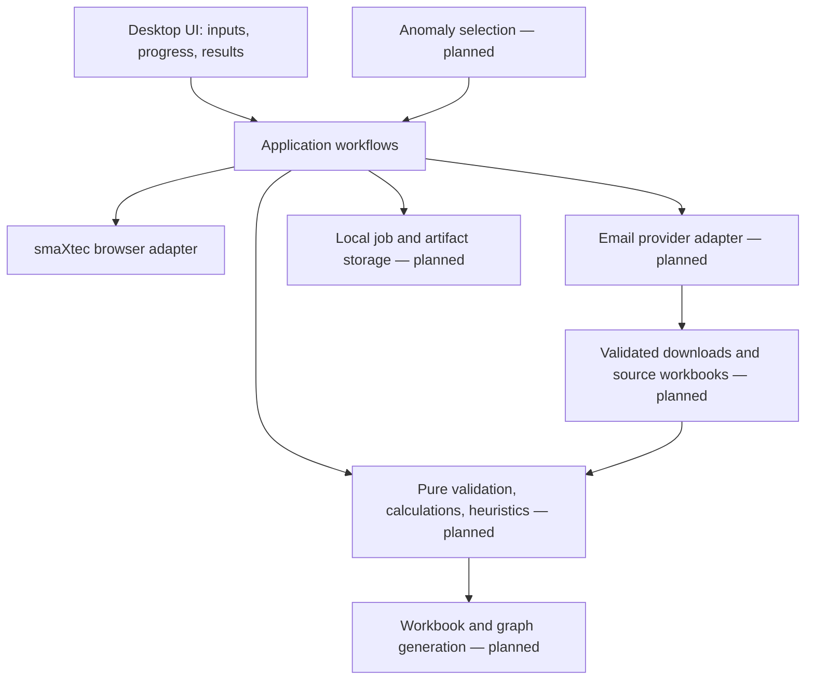

# Architecture and decision record

## North star

A self-contained, approachable desktop application for a nontechnical user.
Initial target: Windows x64, inferred from the current working environment.
Supporting macOS or Linux later is possible, but each requires its own build and
verification. The final deliverable must bundle the language runtime, dependencies,
and automation browser and provide a polished installer and GUI onboarding.

## Boundaries

The automated anomaly path produces the same export-request inputs as manual cow
selection. There must be one collection/normalization/reporting pipeline.

| Location | Responsibility | Must not own |
| --- | --- | --- |
| `src/smaxtec/ui/` | Widgets, styling, worker lifecycle, user feedback | Selectors, formulas, provider logic |
| `src/smaxtec/application/` | Workflow contracts, credentials in memory, progress/errors | Qt widgets, Playwright implementation |
| `src/smaxtec/adapters/smaxtec/` | Browser ownership, login page and verified transitions | Report calculations or email behavior |
| `src/smaxtec/main.py` | Compose the app and concrete adapters | Business workflows |
| `tests/` | Synthetic regression fixtures and UI behavior | Real credentials or live account tests |
| `packaging/`, `scripts/` | Reproducible build and executable checks | End-user package installation |

Create domain/reporting/mail/storage modules when the respective feature is
implemented. Avoid speculative stubs that future agents must untangle.

## Runtime model

Qt runs the GUI on the main thread. A dedicated worker owns a Playwright instance
and browser context. All browser objects are created, used, and closed on that
worker. Progress crosses the boundary as small typed events, never browser
objects. Browser operations have bounded timeouts and cooperative cancellation;
closing the app requests cleanup and waits for the worker to finish.

The browser session remains available after sign-in until the user disconnects,
closes the browser, or closes the application. Credentials live only in memory;
browser storage is ephemeral. Farm/export steps run on that same owning worker.
Application workflows remain testable without Qt or a live account.

Implemented contracts are in `application/login.py`; `ui/worker.py` owns the worker
lifecycle and sanitizes unexpected failures. The concrete adapter is
`adapters/smaxtec/login.py`. `LoginSettings` allows local HTTP fixture origins in
tests; the GUI always uses the fixed HTTPS production origins, never user-entered
login URLs. Authentication uses both the expected origin/route and two live-observed
navigation markers. The browser's continued existence is not ongoing authentication
monitoring; revalidate the session before future export actions.

Credentials are cleared from the GUI on connect, and the worker releases its
credential reference after connection. Python does not guarantee zeroing immutable
strings in memory. No credentials or browser storage are persisted by the app.

## Decision 004: Serialized browser commands and dynamic farm discovery

Status: implemented in M2.

`SessionWorker` owns one session and a thread-safe command queue. It connects,
discovers farms, then processes export batches serially. This preserves Playwright's
thread affinity and prevents multiple GUI clicks from operating on one browser at
the same time. Small immutable requests/results/progress events cross the boundary.

Farms are read from every successful login's organisation modal and sent to the
GUI as `Farm` values. Names are not hard-coded and no organisation IDs are stored
in the GUI. At request time, the adapter reopens the modal and matches the selected
farm name exactly; the site's current `/animals?orgId=…` link supplies the ID.
This naturally includes farms added before the next login. Duplicate display names
would be ambiguous; if the account gains them, discovery must add a stable identity
before allowing selection.

## Decision 005: One reviewed request per exact animal number

Status: implemented in M2.

The GUI accepts comma, semicolon, whitespace or line-separated cow identifiers,
preserves leading zeroes and order, and removes duplicate entries. It uses native
date controls in `DD/MM/YYYY`, prevents future dates, and requires start <= end.
A confirmation dialog shows farm, cow list/count and date range before side effects.

The adapter searches only the header containing `data-testid="orderByMark"`, waits
for filtered table results, and checks exact text in the `mark-link` column. Partial,
missing or duplicate exact matches stop the batch before that cow's export. It uses
the export control inside the confirmed row, two ordered datePicker fields, selects
Measured data explicitly, and clicks the dialog's exact `EXPORT` button once.

Each cow gets an individual request because the required email/download workflow
produces one source workbook per cow. Successful or ambiguous-click attempts are
remembered in memory and skipped for the rest of that session. Completed cows are
reported if a later cow fails. This duplicate guard does not survive application
restart; persistent job state belongs in M3 before unattended/resumable operation.

## Data and workflow design to preserve

- A future export job records a stable job ID, website farm ID + display name,
  cow IDs as strings, explicit start/end and farm timezone, and report settings.
- Clarify inclusive/exclusive boundaries, daylight-saving time, cow number versus
  tag identity, available measurements and units using real samples before coding.
- Each requested cow export gets a tracked state and correlation metadata.
  Emails can arrive out of order, be duplicated, or never arrive. A timeout must
  preserve resumable state. Retrying must not blindly request duplicate exports.
- Preserve original workbooks outside the repository. Normalize into a canonical
  dataset with farm/cow/timestamp/units/source lineage. Validate schema changes,
  missing intervals, duplicates, and numeric parsing before calculation.
- Generate the master workbook and plots from the same validated dataset and
  versioned configuration. Write outputs atomically and make partial results clear.
- Heuristics need version, rationale, inputs, thresholds, and explainable flags.
  Validate against reviewed cases. Keep user oversight and request/rate limits in
  the future unattended collection workflow.
- Local SQLite is the intended job metadata store once persistence is needed.
  Keep large source/output files on disk, not in database blobs. No hosted service
  is required for the initial desktop product.
- Inbox provider, OAuth setup, organizational consent, download domains, retention,
  workbook schema, formulas, graph designs, and anomaly rules remain open.

## Decision 001: Python + Qt + Playwright

Status: accepted for the first increment; revisit with measured evidence.

Python supports the expected tabular/scientific work without adding another
runtime boundary. Qt (PySide6 Essentials) supplies native desktop widgets and
styling with only the Qt modules needed now. Playwright provides browser isolation,
semantic locators, auto-waits, and a controlled Chromium version.

Alternatives considered: Electron would supply web styling but adds another
runtime or forces later analytics into JavaScript; Tauri plus Python introduces
sidecar packaging and Rust for this initial team; a hosted web app requires a
server and centralized account/data operations. None is ruled out forever, but
the single-runtime desktop approach fits the immediate requirements well.

Use PyInstaller in directory mode with a bundled Chromium browser for the first
packaging proof. A directory bundle starts without extracting a large browser on
every launch and can be wrapped by an installer later. Browser bundling increases
download size, which must be measured. A portable archive is an early artifact,
not the final installation experience.

References checked during foundation work:

- [Playwright Python and PyInstaller/browser bundling](https://playwright.dev/python/docs/library#pyinstaller)
- [Playwright threading and event-loop constraints](https://playwright.dev/python/docs/library#threading)
- [Qt for Python deployment](https://doc.qt.io/qtforpython-6/deployment/index.html)
- [PyInstaller operating modes](https://pyinstaller.org/en/stable/operating-mode.html)

## Decision 002: Safe, explicit authentication boundary

Use the supplied public login route and normal browser UI. Select the initial
button by accessible role/name and credential fields by stable `username` and
`password` IDs. Inspect the actual provider and post-login signal before declaring
success. URL navigation alone is insufficient proof of authentication.

Never write passwords/cookies to config, source, logs, or Git. Optional remembered
credentials later require an OS credential vault. Do not bypass MFA or challenges;
make any required human interaction clear and keep it within the browser.

## Decision 003: Build only the current vertical slice

Keep the first interface useful: account fields, connect/cancel/disconnect,
progress, actionable errors. Record subsequent requirements and milestones in
documentation. Do not fill the GUI with working-looking farm, download, or graph
controls before those actions exist.
